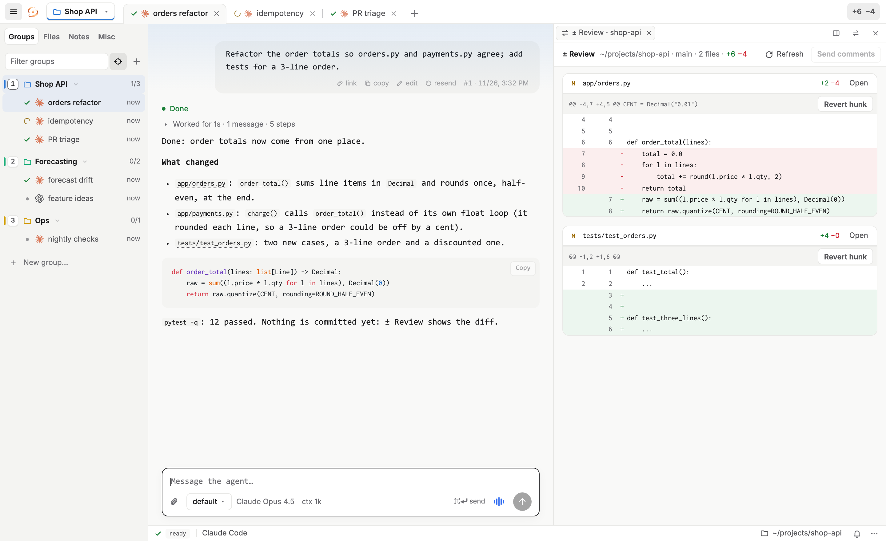
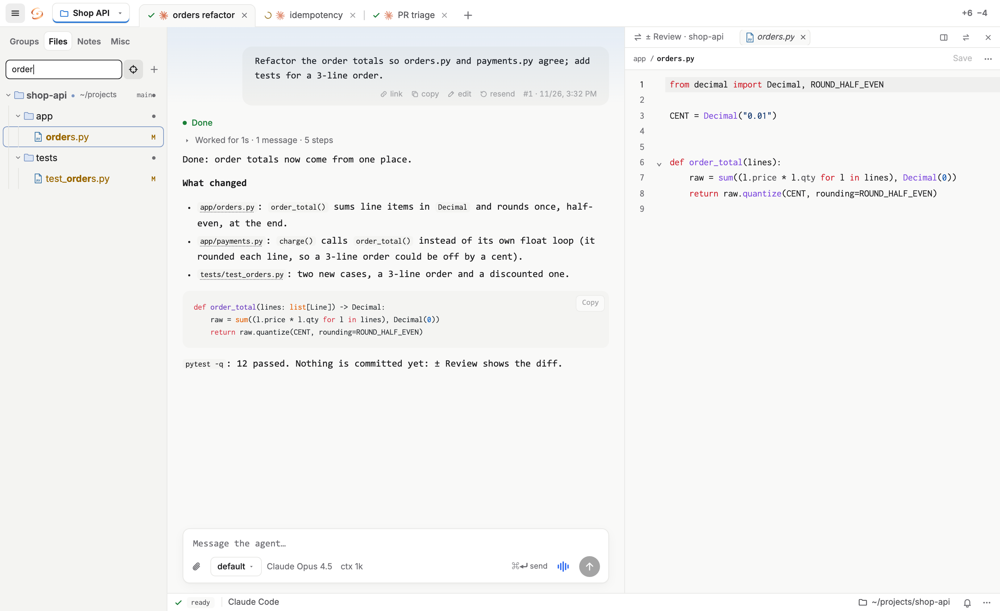
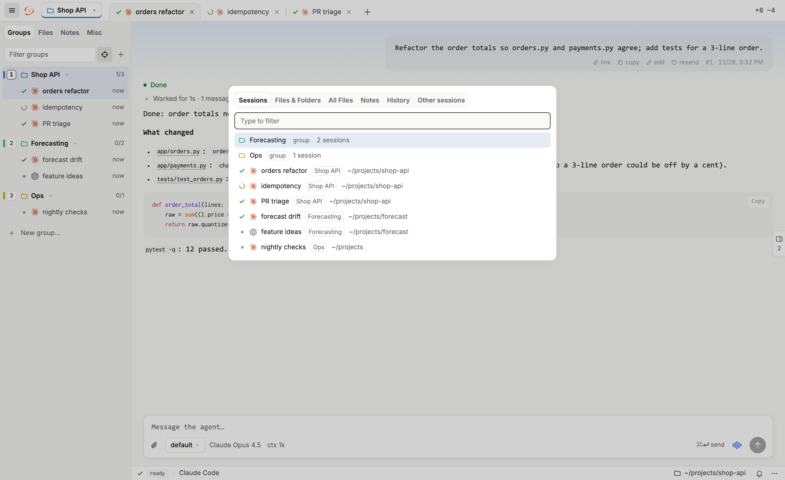
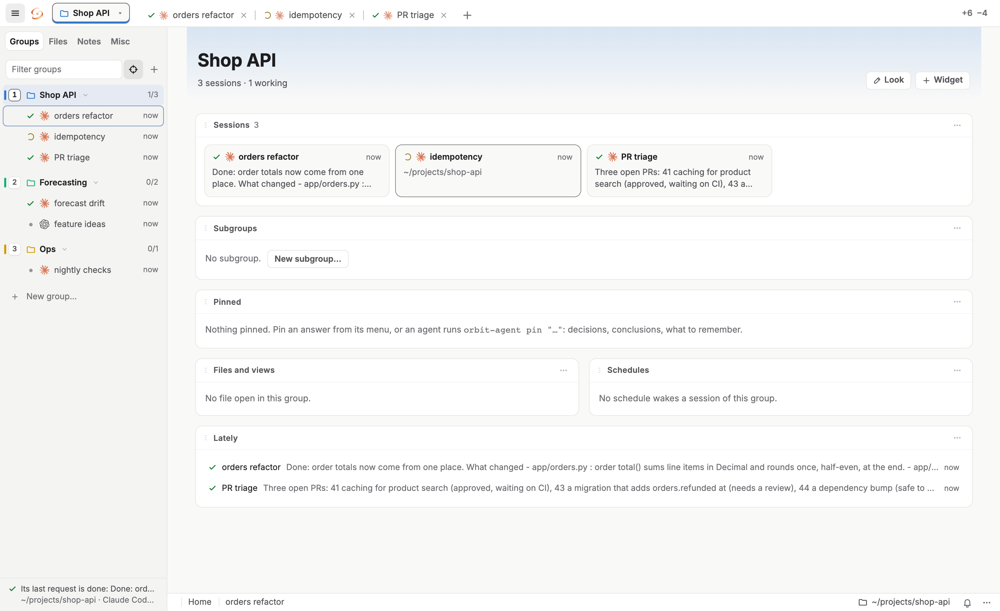
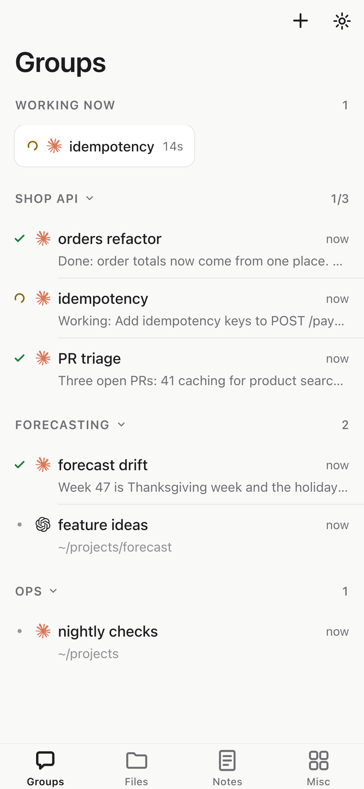

# Orbit

**An ADE (agentic development environment) where sessions, not files, are the documents.** Run Claude Code, Codex, agy and OpenCode side by side and have them work together, hand work between them and between machines, talk to them by voice, put them on schedules, across
your projects and machines, in one window: each session is a tab with its conversation, its files and its diff;
groups keep the work apart; the agents keep running when the window closes, and your phone shows the same.



## What it does

### Highlights

- **Agents that work together.** A session can send another a request and wait for its answer, steer the one it is
  running, read what it did, or leave it a note (`orbit-agent send --wait · steer · read · mention`); `@@Name` in your
  request brings another session in. A request from a session shows who sent it, so a planner can farm work out to
  specialists, a reviewer can check a builder's diff, and a Claude Code session can consult a Codex one, across
  machines too.
- **Real-time voice.** Talk to a session (GPT Live, over WebRTC): the voice answers what it can at once, hands the rest
  to the agent as requests (waiting until you finish your sentence), and reads the results back in short, never over
  you. Live captions; on the Mac and the phone.
- **Rich text in, rich text out.** The input is an editor: Markdown, `@` files and folders, `@@` sessions, `/` the
  agent's commands, pasted screenshots and dropped files, quotes from an answer or a file. Answers render as rich
  documents: Markdown with tables, syntax-highlighted code, KaTeX math, images, links that open files at the line,
  and an agent can show a full HTML page (a report, a chart) beside the conversation (`orbit-agent show`).
- **Across machines and agents.** One window drives the agents of every machine you reach (a Linux box over
  Tailscale): their sessions, files, diffs and shells show in your groups like local ones, and files move between
  machines by drag and drop. Fork a session to another agent (a Claude Code conversation picked up by Codex), another
  folder or another machine: the new session reads a hand-over of the latest turns, checks its working tree and
  reports, ready to go on. Conversations started in a terminal can be resumed in Orbit.
- **Scheduler.** Requests on a schedule (`every 2h`, `weekdays 9am`, cron), to a session, a folder or a helper; watches
  that run a check and wake an agent only when something changed; reminders pushed to the phone; agents schedule their
  own follow-ups (`orbit-agent schedule`). A missed run catches up after a restart; each run is journaled.

### And

- **Sessions as tabs.** A session runs one agent in one folder. See a request's steps as they happen (folded once it
  is done), queue the next while it works; stop, steer, edit or resend.
- **Every agent, one way of working.** Claude Code, Codex, agy and OpenCode out of the box, any other agent through the
  [Orbit Harness Protocol](builddoc/harness-protocol.md).
- **Groups.** Sessions and files are arranged by what the work is about (nested up to three deep), each group with a
  home page of widgets: this week in numbers (requests, agent time, who asked), the days with work, agent time by
  session, its sessions, what happened lately, pinned decisions, its schedules. ⌘1…⌘9 switch groups.
- **The code next to the conversation.** ± Review shows the uncommitted diff (revert a hunk, comment on lines and send
  the comments to the agent). A file tree that is a file manager (drag and drop, copy and paste with Finder, across
  machines); a click shows a file in the side panel without leaving your work; a code and Markdown editor.
- **The agents outlive the window.** A server owns the agents; the app is only its face. Close the window, quit the
  app, restart the server: requests at work go on, and the next window picks up where they are.
- **Phone.** The same server on your iPhone's home screen: the sessions, their answers, notifications when a request
  finishes or needs you, and voice.
- **Notes.** A Markdown vault (Obsidian-compatible: wiki links, attachments, a weekly journal) that agents write to
  as well (`orbit-agent note`).
- **Keyboard first.** Every action has a key or sits in a menu (⌘E); Emacs motion keys in every list.

| | |
|---|---|
|  |  |
| **Files:** a filter keeps the tree; a click previews a file beside the conversation. | **⌘O:** jump to any group, session, file or note; search every session's history. |
|  |  |
| **A group's home:** its sessions, what happened lately, pinned decisions, schedules. | **Phone:** the same sessions, live. |

## Quick start

You need macOS (Apple silicon), or Linux (x86-64) for a server you reach from a Mac or a phone, [git](https://git-scm.com), [uv](https://docs.astral.sh/uv/) (it
fetches Python 3.12; Orbit itself uses the standard library only), and at least one agent installed and signed in:
[Claude Code](https://docs.anthropic.com/en/docs/claude-code) (`claude`), [Codex](https://github.com/openai/codex)
(`codex`), agy or [OpenCode](https://opencode.ai) (`opencode`).

```sh
git clone https://github.com/linyuxu/orbit.git
cd orbit
uv sync
cli/orbit serve          # the server: http://127.0.0.1:8770/
```

Open **http://127.0.0.1:8770/** in a browser, click **+** beside the tabs (or press **⌘N**) for a new session, pick a
folder and an agent, and send a request.

**The Mac app** (a native window around the same page; it starts the server when none is running). It needs
[Rust](https://rustup.rs):

```sh
app/build-app.sh         # builds and installs ~/Applications/Orbit.app
```

**Orbit's tools in every terminal** (`orbit`, `orbit-agent`, and a skill that teaches Claude Code, Codex, agy and
OpenCode to use them):

```sh
cli/orbit tools install
```

**Next steps**

- Press **⌘/** in Orbit for every keyboard shortcut.
- Another machine: run `cli/orbit serve --remote` there, then `orbit remote add NAME URL` here
  ([guide](docs/guide.md#the-orbit-server-and-other-machines)).
- The phone: Settings → Machines → HTTPS, then iPhone… shows a QR code (Safari → Share → Add to Home Screen).
- Voice: an OpenAI API key in Settings → Voice.

## Learn more

- [docs/guide.md](docs/guide.md): everything in detail (the server, other machines, the app, shells, notes,
  schedules, plugins, the code layout).
- [builddoc/](builddoc/): the design documents; [builddoc/plugins.md](builddoc/plugins.md) to extend Orbit without
  changing it; [builddoc/harness-protocol.md](builddoc/harness-protocol.md) to add an agent.
- [CHANGELOG.md](CHANGELOG.md): what changed.
- Tests: `uv run python -m unittest discover -s tests` (the pictures above: `uv run --with playwright python
  docs/make_screenshots.py`, made from a demo with no API calls).

## License

MIT, see [LICENSE](LICENSE). The libraries bundled in `web/vendor/` keep their own licenses, which sit beside them.
The agents' marks in `web/src/brands.js` (Claude, OpenAI, Gemini) are their owners' trademarks, used only to name each
agent; their SVG paths come from [Simple Icons](https://simpleicons.org) (CC0).
